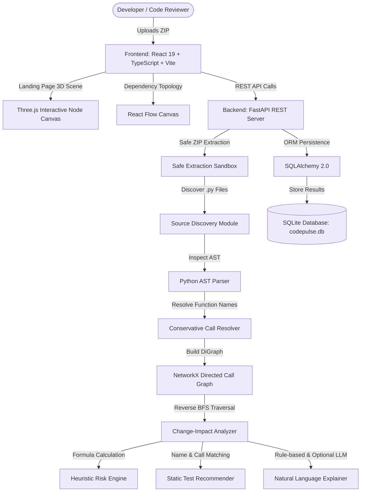

# CodePulse AI

> **An Intelligent Code Change Impact Analysis and Test Recommendation System**  
> *Understand the impact of every code change.*

---

## Academic Project Credentials
- **Student**: NAVEEN KUMAR M
- **Register Number**: 710123205026
- **Department**: Department of Information Technology
- **Institution**: Adithya Institute of Technology
- **Academic Year**: 2026–2027

---

## 1. Project Overview

**CodePulse AI** is a developer platform and static code analysis system designed to help software engineers understand the blast radius of modifying a function in a Python repository. 

When modifying code in complex applications, changing a foundational routine can ripple through upstream callers, introducing unexpected behavioral regressions. CodePulse AI extracts Python Abstract Syntax Trees (AST) without executing any project code, constructs a directed call graph (caller → callee), performs reverse Breadth-First Search (BFS) graph traversal to discover reachable callers, computes a transparent heuristic risk score (0–100), and discovers candidate unit tests.

---

## 2. System Architecture



---

## 3. Technology Stack

### Frontend
- **Framework**: React 19 with Vite & TypeScript
- **Styling**: Tailwind CSS v4 with custom design tokens & glassmorphism
- **3D Visualization**: Three.js (dynamic function nodes, glowing call lines, particle network, mouse parallax)
- **Dependency Graph**: `@xyflow/react` (React Flow) with custom glowing function nodes
- **Routing**: React Router v7
- **Icons**: Lucide React
- **API Client**: Axios

### Backend
- **Framework**: FastAPI (Python 3.10+)
- **Static Analysis**: Python standard `ast` module (zero code execution)
- **Graph Algorithms**: NetworkX 3.x (Directed call graphs, cycle-safe reverse BFS)
- **Database ORM**: SQLAlchemy 2.0 with SQLite
- **Validation**: Pydantic v2
- **Testing**: pytest, pytest-asyncio, pytest-cov, Starlette TestClient
- **Optional AI**: OpenAI API integration with fallback to local rule-based engine

---

## 4. Key Features

1. **Awwwards-Inspired 3D Landing Page**:
   - Interactive Three.js canvas featuring floating function nodes, pulsing dependency edges, an abstract analysis core, and gentle pointer-responsive parallax.
   - Comprehensive workflow explanation, mathematical formula breakdown, and academic project credits.

2. **Secure Upload & AST Extraction**:
   - Accepts `.zip` archives containing Python projects.
   - Strict path-traversal prevention, maximum archive expansion limits, and automatic cleanup of temporary extraction directories.
   - 100% static analysis: uploaded source code is **never executed**.

3. **Interactive React Flow Dependency Graph**:
   - Visualizes functions as nodes and recognized function calls as directed edges (`caller → callee`).
   - Custom nodes displaying module paths, line numbers, and class contexts.
   - Interactive pan, zoom, fit-to-view, function search, and drawer inspection.

4. **Change-Impact Analysis & Reverse BFS Traversal**:
   - When a function changes, the analyzer traverses reverse call edges to identify all upstream callers that may be affected.
   - Cycle-safe BFS traversal prevents infinite loops on recursive and circular dependencies.

5. **Deterministic Heuristic Risk Engine (0–100)**:
   - **Documented Formula**:
     $$\text{Score} = \min(100, (\text{direct\_callers} \times 10) + (\text{transitive\_callers} \times 3) + (\text{max\_depth} \times 5) + (\text{dependency\_paths} \times 2))$$
   - **Risk Categories**:
     - `0 – 24`: **Low** — Minimal visible call-graph exposure
     - `25 – 49`: **Medium** — Standard review is appropriate
     - `50 – 74`: **High** — Detailed review recommended before shipping
     - `75 – 100`: **Critical** — Requires immediate and thorough review

6. **Static Test Recommendation**:
   - Discovers candidate test functions from naming conventions (`test_*`, `*_test`) and AST call body references.
   - Assigns confidence levels (`high`, `medium`, `low`) without executing untrusted test code.

7. **Persisted Analysis History & SQLite**:
   - Every impact analysis is stored in SQLite for auditable review tracking and historical comparison.

---

## 5. Getting Started & Installation

### Prerequisites
- Python 3.10 or higher
- Node.js 18 or higher & npm

### Clone the Repository
```bash
git clone https://github.com/Naveenkumar291205/codepluse-ai.git
cd codepluse-ai
```

---

### Backend Setup

1. **Navigate to the backend directory**:
   ```bash
   cd backend
   ```

2. **Install Python dependencies**:
   ```bash
   pip install -r requirements.txt
   ```

3. **Configure environment (optional)**:
   ```bash
   cp .env.example .env
   ```
   *(Add `OPENAI_API_KEY` in `.env` if you wish to use OpenAI explanations; otherwise the local rule-based explainer is used automatically).*

4. **Run backend tests**:
   ```bash
   python -m pytest tests -v
   ```

5. **Start the FastAPI backend server**:
   ```bash
   python -m uvicorn app.main:app --host 127.0.0.1 --port 8000 --reload
   ```
   - API Server: `http://localhost:8000`
   - Interactive Swagger API Docs: `http://localhost:8000/api/docs`

---

### Frontend Setup

1. **Navigate to the frontend directory**:
   ```bash
   cd ../frontend
   ```

2. **Install frontend dependencies**:
   ```bash
   npm install
   ```

3. **Run the production build verification**:
   ```bash
   npm run build
   ```

4. **Start the frontend development server**:
   ```bash
   npm run dev
   ```
   - Web Application: `http://localhost:5173` (or `http://localhost:5174`)

---

## 6. Sample Project Walkthrough

A pre-configured sample project is provided in `sample-project/` representing an e-commerce order processing module:
- `sample-project/ecommerce/pricing.py`: Defines `calculate_price()`, `apply_discount()`, `generate_invoice()`, and `notify_customer()`.
- `sample-project/tests/test_pricing.py`: Unit tests for the pricing logic.
- `sample-project/ecommerce_sample.zip`: Ready-to-upload archive.

### Reproducible Demonstration:
1. Open the CodePulse AI studio at `/app/projects`.
2. Upload `ecommerce_sample.zip`.
3. Navigate to **Dependency Graph** (`/app/graph`) to view the caller-callee hierarchy.
4. Select `calculate_price` and click **Analyze Impact**.
5. Observe:
   - **Direct Callers**: `generate_invoice`
   - **Transitive Callers**: `notify_customer`, `process_order`
   - **Heuristic Risk Score**: Calculated according to the documented formula.
   - **Candidate Tests**: Discovers `test_calculate_price` with **High** confidence.
   - **Persisted History**: Saved to SQLite and viewable in `/app/history`.

---

## 7. Automated Test Results

The backend contains automated tests covering source discovery, AST parsing, call resolution, cycle safety, reverse graph traversal, risk scoring, test recommendation, zip validation, and end-to-end API workflows:

```text
============================= test session starts =============================
platform win32 -- Python 3.14.5, pytest-9.1.1, pluggy-1.6.0
collected 37 items

tests/test_analyzer.py::TestSourceDiscovery::test_discovers_python_files PASSED
tests/test_analyzer.py::TestSourceDiscovery::test_excludes_pycache PASSED
tests/test_analyzer.py::TestSourceDiscovery::test_empty_directory PASSED
tests/test_analyzer.py::TestASTParser::test_extracts_functions PASSED
tests/test_analyzer.py::TestASTParser::test_function_line_numbers PASSED
tests/test_analyzer.py::TestASTParser::test_function_calls_extracted PASSED
tests/test_analyzer.py::TestASTParser::test_docstring_extraction PASSED
tests/test_analyzer.py::TestASTParser::test_syntax_error_handled PASSED
tests/test_analyzer.py::TestASTParser::test_qualified_name_top_level PASSED
tests/test_analyzer.py::TestASTParser::test_method_detection PASSED
tests/test_analyzer.py::TestASTParser::test_empty_file PASSED
tests/test_analyzer.py::TestCallResolver::test_resolves_direct_call PASSED
tests/test_analyzer.py::TestCallResolver::test_no_self_references PASSED
tests/test_analyzer.py::TestCallResolver::test_resolve_all_returns_edges PASSED
tests/test_analyzer.py::TestCallResolver::test_unresolved_calls_not_included PASSED
tests/test_analyzer.py::TestDependencyGraph::test_graph_has_nodes PASSED
tests/test_analyzer.py::TestDependencyGraph::test_graph_has_edges PASSED
tests/test_analyzer.py::TestDependencyGraph::test_direct_callers PASSED
tests/test_analyzer.py::TestDependencyGraph::test_reverse_traversal PASSED
tests/test_analyzer.py::TestDependencyGraph::test_cycle_safety PASSED
tests/test_analyzer.py::TestDependencyGraph::test_graph_data_export PASSED
tests/test_analyzer.py::TestImpactAnalyzer::test_analyze_direct_callers PASSED
tests/test_analyzer.py::TestImpactAnalyzer::test_analyze_affected_count PASSED
tests/test_analyzer.py::TestImpactAnalyzer::test_analyze_unknown_function PASSED
tests/test_analyzer.py::TestImpactAnalyzer::test_analyze_includes_limitations PASSED
tests/test_risk_scoring::TestRiskScoring::test_score_range PASSED
tests/test_risk_scoring::TestRiskScoring::test_low_risk_for_leaf_function PASSED
tests/test_risk_scoring::TestRiskScoring::test_risk_categories PASSED
tests/test_risk_scoring::TestRiskScoring::test_contributing_factors PASSED
tests/test_test_recommender::TestTestRecommender::test_finds_name_based_tests PASSED
tests/test_test_recommender::TestTestRecommender::test_no_fabricated_tests PASSED
tests/test_test_recommender::TestTestRecommender::test_confidence_levels PASSED
tests/test_zip_validation::TestZipValidation::test_valid_zip PASSED
tests/test_zip_validation::TestZipValidation::test_invalid_zip PASSED
tests/test_zip_validation::TestZipValidation::test_path_traversal_detection PASSED
tests/test_e2e_api.py::test_health_check PASSED
tests/test_e2e_api.py::test_full_project_analysis_workflow PASSED

======================= 37 passed in 2.32s =======================
```

---

## 8. Static Analysis Boundaries & Limitations

1. **Dynamic Dispatch & Duck-Typing**: Runtime polymorphism and methods called on abstract interfaces without explicit types are not resolved.
2. **Reflection**: Calls through `getattr()`, `hasattr()`, or `eval()` cannot be statically followed.
3. **Monkey-Patching**: Runtime replacement of modules or functions is bypassed by static AST inspection.
4. **Candidate Test Recommendations**: Tests are suggested based on static AST indicators, not runtime test execution or dynamic code coverage.

---

## 9. License & Academic Attribution
Developed as an academic mini project for the Department of Information Technology at **Adithya Institute of Technology** (Academic Year 2026–2027) by **NAVEEN KUMAR M** (Reg No: 710123205026).